# Projectional Editor for .NET

[](LICENSE)


A **projectional editor** for .NET, modelled after JetBrains MPS: models are trees of nodes, not text buffers. Notation is *projected* from the model, and every keystroke is interpreted as a structural edit. This makes it possible to define domain-specific languages without writing a parser, and to give each language a notation that fits the domain—text-like, tabular, form-based, or diagrammatic.

The editor is designed to be embedded as a component in other .NET applications: either as a design-time language workbench, or as an end-user model editor inside a shipped product.

---

## Table of Contents

- [Why Projectional?](#why-projectional)
- [Status](#status)
- [Quick Start](#quick-start)
  - [1. Run the Standalone Editor](#1-run-the-standalone-editor)
  - [2. Define a Language](#2-define-a-language)
  - [3. Build a Model](#3-build-a-model)
  - [4. Embed the Editor](#4-embed-the-editor-in-your-application)
  - [5. Save and Load](#5-save-and-load)
  - [6. Report a Problem](#6-report-a-problem-in-the-document)
- [What the Editor Does](#what-the-editor-does)
  - [Feature Gallery](#feature-gallery)
- [Project Architecture](#projects-architecture)
- [Documentation](#documentation)
- [Build and Test](#build-and-test)
- [Known Limitations](#known-limitations)
- [Non-Goals](#non-goals)
- [License](#license)

---

## Why Projectional?

- **No parser, no invalid syntax.** Every keystroke is an edit action against a model that is validated on every mutation, so a document cannot be in a state the language forbids.
- **Notation is a view, not a source file.** The same ruleset is drawn as a block or as a table ([ADR 0012](docs/adr/0012-concept-rendered-more-than-one-way.md)); the choice is view state and never touches the model.
- **Cells, not characters.** The caret moves between *cells* the projection produced. Arrows move by cell, `Ctrl`+arrows by character, so a press never creeps through a seven-character property one letter at a time.
- **The model is the only truth.** No text buffer, no whitespace semantics, no "sync the text back into the tree" path ([ADR 0002](docs/adr/0002-model-as-source-of-truth.md)).

---

## Status

| Metric | Details |
| --- | --- |
| **Milestones** | **M0, M1, M2 and M3 complete**, **M4 about half**, **M5 started** |
| **Runtime** | `net10.0`, C# 14, Avalonia 12 |
| **Tests** | 1888 passing (`dotnet test`) |
| **CI** | Windows and Linux, plus a Linux-only job that guards the file format |

### What that means in practice:
You can declare a language in C# or as a model, project it, open a document, edit it structurally with keyboard and mouse, copy and paste, undo and redo, complete slots, switch a concept's representation, see diagnostics as squiggles and repair them from the intention list, preview an intention by hovering it, find and replace, browse the model, read the problems panel, reopen a recent file, show line numbers, zoom the font, scroll a document larger than the window with real scrollbars, run a document and read its trace, generate its text from its own templates, and save to XML and load it back byte-identically.

*Not there yet:* the rest of M4 (the remaining standard checks and the cross-check tests), M5's self-hosting (a language browser, live preview, language creation), and everything from M6 on - the shell as an embeddable library, then installers. What is finished is recorded in [implemented.md](docs/implemented.md); what is left is in the [roadmap](docs/roadmap.md).

---

## Quick Start

### 1. Run the standalone editor

```powershell
git clone <this repository>
cd "dotnet projectional editor"
dotnet run --project src/Projectional.Workbench
```

The workbench opens with the sample rules language. Tabs hold documents and each one closes from the button in its header, the strip scrolls sideways when there are more than fit and a "+" at its right end opens an empty document, a file dragged onto the window opens as a document (or is offered to the importers), the outline beside the page lists the active document's nodes and is as wide as you drag it, and the status bar tracks the active one - the caret's line and column, the language, the theme and the font size, plus any problem count while the problems tab is closed. Output, Problems and Usages are tabs of one strip under the document: drag the splitter to size it, close a tab to give the page its room back, and **View ▸ Panels** brings it back. Closing a modified tab asks before it discards anything.

| Menu | Entries |
| --- | --- |
| **File** | New (a submenu: document `Ctrl+N`, concept, enumeration, notation, document of an opened language), Open… (`Ctrl+O`), Open language…, Export language to C#…, Import…, Recent, Save (`Ctrl+S`), Save as… (`Ctrl+Shift+S`), Save generated text as…, Close document (`Ctrl+W`), Exit |
| **Edit** | Undo (`Ctrl+Z`), Redo (`Ctrl+Shift+Z`), Cut (`Ctrl+X`), Copy (`Ctrl+C`), Paste (`Ctrl+V`), Select all (`Ctrl+A`), Find… (`Ctrl+F`), Replace… (`Ctrl+H`), Find usages (`Alt+F7`), Rename… (`Shift+F6`) |
| **Run** | Run document (`F5`), Run tests, Generate text (a submenu per generator the language declares), Clear output |
| **View** | Find… (`Ctrl+F`), Find usages (`Alt+F7`), Panels (Output, Problems, Usages), Representation (one submenu per concept with more than one variant), Reset column widths, Line numbers, Increase font size (`Ctrl+=`), Decrease font size (`Ctrl+-`), Reset font size (`Ctrl+0`), Follow system theme, Light theme, Dark theme |

### 2. Define a language

A language consists of concepts (the model) plus notation (the view). Both are plain data:

```csharp
ConceptDeclaration[] declarations =
[
    new("Todo.List",
        [
            new PropertySlot("name", PropertyType.String, "todo"),
            new ChildSlot("items", "Todo.Item"),
        ],
        nameSlot: "name"),

    new("Todo.Item",
        [
            new PropertySlot("title", PropertyType.String, "untitled"),
            new PropertySlot("done", PropertyType.Boolean, "false"),
        ],
        nameSlot: "title"),
];

var concepts = ConceptRegistry.Create(declarations);
var notations = new NotationRegistry(concepts);

notations.Add("Todo.List", ed => ed.Sequence(
    ed.Line(ed.Keyword("todo", TextEmphasis.Bold), ed.Space, ed.Property("name"), ed.Space, ed.Punct("{")),
    ed.Indent(ed.Children("items")),
    ed.Line(ed.Punct("}"))));

notations.Add("Todo.Item", ed => ed.Line(
    ed.Punct("-"), ed.Space, ed.Property("done"), ed.Space, ed.Property("title")));
```

`Sequence` stacks blocks vertically, `Line` runs cells horizontally, `Indent` stacks them one level deeper, and every slot cell names the slot it shows. The inline/block split is carried by the type system rather than by validation: `Line` takes inline cells and `Sequence` takes block cells, so `ed.Line(ed.Indent(...))` does not compile.

Notation is validated at the `Add` call, not at render time: a cell naming a slot the concept does not declare, a duplicate notation, or a single-child cell on a list slot is rejected there and leaves the registry clean. A concept with no notation at all still opens and displays—it shows as a missing-notation placeholder, because a language is written concept by concept.

### 3. Build a model

```csharp
var project = new Project(concepts);
var model = project.NewModel("todos");

var list = model.NewNode("Todo.List");
model.AddRoot(list);

var item = model.NewChild(list, "items", "Todo.Item");
item.Set("title", "write the README");
```

`Project` is the identity scope: node IDs are stable GUIDs that are unique within it and never renumbered. Every mutation runs inside a transaction and emits change events, which is where undo, the dirty flag, and the projection's rebuild come from—nothing observes the model by polling.

### 4. Embed the editor in your application

```csharp
var editor = new ProjectionalEditorControl
{
    FontSize = 16,
    ShowLineNumbers = true,
};

editor.Session = new EditorSession(list, notations, editor.TextMeasure);
```

Two statements rather than one object initializer, because the session needs the *control's own* measure: layout has to be computed with the same font the control paints with, or the caret and the glyphs disagree.

**Every project under `src/` is published as a NuGet package**, so embedding starts with a reference rather than a folder in your solution:

```xml
<PackageReference Include="Projectional.Avalonia" Version="*" />
<PackageReference Include="Projectional.Toolkit" Version="*" />  <!-- what a language is written against -->
```

A language is one package too (`Projectional.Json`, `Projectional.Xml`, …), carrying its own checks and intentions, so a host that wants JSON takes `Projectional.Json` and nothing else. Versions are derived from the repository's tags and a release is a `v*` tag ([ADR 0022](docs/adr/0022-every-project-is-a-package.md), [packaging.md](docs/architecture/packaging.md)). Until the project's first tagged release these are `ProjectReference`s, so today the two lines above are the shape rather than a published feed.

Everything else—palette, marker colors, caret brush, gutter colors, typeface—is an optional property on the control, so a host can theme the editor without touching the model. The control has a parameterless constructor, so it can also be placed in XAML and sized by the surrounding layout.

### 5. Save and load

```csharp
ModelFile.Save(model, "todos.mps");

var reopened = new Project(concepts);
var reloaded = ModelFile.Load(reopened, "todos.mps");
```

Loading needs a project of its own: a project holds each node ID at most once, so opening a document into a project that already contains it reports a duplicate ID rather than silently merging two copies of the same nodes.

The format is XML, written so that a reader sees either the old file or the new one and never a half-written mixture: bytes go to a temporary file next to the target, are flushed to disk, and only then take the target's place. Serialization is byte-stable—slot order is declaration order, attribute order is fixed, LF endings, UTF-8 without BOM, two-space indent—so save → load → save produces identical bytes across the whole corpus ([ADR 0005](docs/adr/0005-xml-persistence.md)). Loading never drops data: an unknown concept, an unknown property, or an unresolvable reference is preserved and reported as a diagnostic.

### 6. Report a problem in the document

Diagnostics are view state, so they are handed to the session and never stored in the model:

```csharp
editor.Session.Markers = new MarkerSet(
    new Diagnostic(DiagnosticSeverity.Error, item.Id, "The title is still a placeholder.", role: "title"));
```

A diagnostic names a node plus a slot and an optional range within that slot's value. It never names a cell or a screen position, because cells are derived—so a check can run on a model nobody is drawing, and a diagnostic survives a notation change.

The set is a snapshot, not a subscription: republish it after every change to the model, or the marks will describe the document as it was before the edit. Replacing the set is cheap (the control repaints and keeps its tree and layout), so a host can run its checks on every committed transaction. `Projectional.Workbench` does exactly that—its `DefaultNames` check marks every node whose name is still its concept's placeholder, and it is the reference for what a host can do with the public surface alone.

Hovering a mark opens a small box with the severity, the message, and the diagnostic's code. The box is drawn by the control rather than by a popup window, so it stays inside the control's own bounds and shows up in a screenshot like the rest of the document.

---

## What the Editor Does

### Editing Gestures

| Gesture | Action |
| --- | --- |
| `←` / `→` | Previous / next cell |
| `Ctrl` + `←` / `Ctrl` + `→` | Previous / next character |
| `↑` / `↓` | Previous / next line, keeping the column |
| `Home` / `End` | Start / end of the line |
| `Tab` / `Shift` + `Tab` | Next / previous slot |
| `Enter` | Insert a child, or a line break inside a text cell |
| `Alt` + `↑` / `Alt` + `↓` | Move the node under the caret |
| `Backspace` / `Delete` | Delete a character, or the node when no text is left |
| `Ctrl` + `A` | Widen selection: value → node → document |
| `Ctrl` + `C` / `Ctrl` + `X` / `Ctrl` + `V` | Copy / cut / paste |
| `Ctrl` + `Z` | Undo |
| `Ctrl` + `Y` / `Ctrl` + `Shift` + `Z` | Redo |
| `Ctrl` + `Space` | Completion |
| `Esc` | Dismiss completion popup |

Keys held with `Ctrl`, `Alt`, or `Meta` belong to the host application, with two exceptions: `Ctrl` + arrows (plain arrows move a whole cell) and `Alt` + `↑`/`↓` (vertical arrows do nothing else). A refused edit stays unconsumed, so a letter typed into a number leaves the event open for the host to beep or reroute.

### Key Highlights
- **Structural editing:** `Enter` fills an empty slot with the concept the language says is most likely; `Backspace` at a boundary deletes the node instead of doing nothing; `Tab` walks slots in notation order.
- **Completion with pictures:** `Ctrl` + `Space` offers valid concepts or enumeration values. Icons are vector `IImage`s, not glyphs.
- **Described context menu:** Right-click menu is built from the same action objects the keyboard uses.
- **Selection ladder:** `Ctrl` + `A` climbs from value to node to document. `Delete` acts on whatever rung is selected.
- **Mouse precision:** Double-click selects a word, triple-click selects the whole value.
- **Working clipboard:** Copy and cut capture selected text; paste validates input against slot types.

### View Features

| Feature | Description |
| --- | --- |
| **Syntax Highlighting** | The projection defines cell meaning; a swappable palette defines appearance. Swapping palettes triggers a simple repaint, not re-projection. |
| **Emphasis** | Bold, italic, underline, and strikethrough declared by notation. |
| **Line Numbers** | Optional gutter aligned with projected lines. |
| **Markers** | Diagnostics drawn as colored squiggles (solid for error/warning, dotted for info/hint). |
| **Font Size** | Scalable from code or via View menu (`6` to `48`). |
| **Themes** | Preset Light and Dark palettes, with custom factory support. |
| **Representations** | Concepts can have multiple view variants switchable on the fly. |

### The C# base language

`Projectional.CSharp` ships with the shell rather than sitting in a folder you open first, because it is a *base* language in the MPS sense: the logic inside a behaviour, a generator or a constraint is written in the same editor as the DSL, not in a text file beside it. A language declares a slot over `CSharp.Expression` and its users write code there, so a DSL never has to grow an expression language of its own.

It is data like every other language here - 47 concepts, a notation, four rules, five intentions and a generator, and no importer - so what you see below is the projection, and the generator writes the same characters back out. Names are references that resolve to the declaration they mean, which is what makes go-to-definition and rename work; `Console` is red because it points at nothing this file declares, and the reference keeps the text it was typed as.

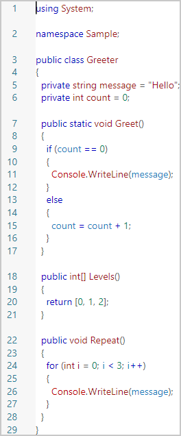

The subset is deliberate and growing: declarations, fields, methods, constructors, auto-properties, parameters, classes, interfaces and their inheritance lists, blocks, `if`/`else`, `while`, `for`, `foreach`, `break`, `continue`, `return`, `throw`, `try`/`catch`/`finally`, assignment with the compound operators, locals, calls, member access, ten binary operators, unary operators in both their prefix and their postfix form, a ternary, casts, `is`, index access, literals, parentheses, `new`, **file-scoped namespaces** (one concept with one boolean - the braced form is the same node) and **collection expressions** (`[0, 1, 2]`). What is still missing is listed in [docs/architecture/csharp.md](docs/architecture/csharp.md).

### Example Languages

Three worked examples ship as their own packages (`src/Languages/Samples/Projectional.Samples.*`). Each proves an axis the framework bets on, and each is drawn here from its own notation registry - so the picture is that language, not the sample rules language wearing a different document.

```powershell
dotnet run --project tools/Projectional.Screenshots
```

#### State machine: references, one concept in two notations

A transition *references* its source and its target—the same state node is reached from many arrows, which is what makes a graph out of a tree—and carries an optional guard written in the shared expression sub-language. The checks package reports the state nothing leads into.

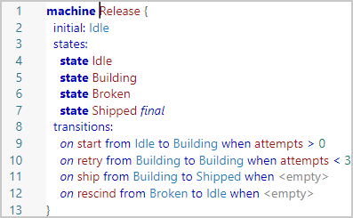

The same document in the concept's second notation, chosen at projection time and never persisted ([ADR 0012](docs/adr/0012-concept-rendered-more-than-one-way.md)). `source` and `target` are columns because a reference is one slot with one value:

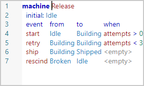

#### Feature model: constraints that read references

`requires` and `excludes` are nodes of their own over an abstract base, so a rule about two features is something the interpreter can run, the check can read and the generator can ignore. The selection is a property, because a configuration is saved and undone with the document:

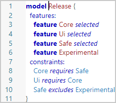

#### SQL schema: cross-model references and the table cell in earnest

Tables are a grid of columns, and a key names a column of *another document* of the same project—two `.mps` files, no import list. This example is what closed the reference-column gap and the cross-model reference rule:

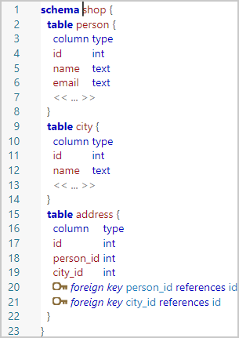

### Tests as data: a language's own test, written in the test language

A language's tests are documents, not C#. A `tests/` folder beside the aspects holds one test per document, written in the test language: it names the document it is about and makes one assertion, and the runner turns each row into a diff when it fails. Ten assertions are closed over: `RoundTrips` (write, read back, write again), `Draws` (the notation at a stated width), `Findings` (the findings the language's own constraints report), `Generates` (one named generator's text, line by line), `Imports` (the round trip through a generator's own inverse), `Reads` (a text file, through a declared importer, to the text a generator prints), `Evaluates` (the interpreter's answer, or the message of the failure that stopped it), `Script` (the editor test: a caret, typing, a key and an offer, replayed through the editor's own input routing, then drawn), `TypeOf` (the type a node has) and `ScopeOf` (which names a reference slot sees). A node - for the last two, and for the caret a script moves - is named by the text the document shows at it, so no test spells a node id. The picture is a drawing assertion over the pipeline sample, with the table it expects beneath it:

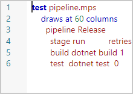

```csharp
var language = LanguageProject.Open("samples/declared-pipeline", out var error);

if (language is null)
{
    throw new InvalidOperationException(error);
}

// A test that evaluates needs its language's evaluation rules as the second argument - a language
// project carries no evaluation aspect to read them from. The pipeline sample declares none, so its
// folder needs only itself.
var report = TestRunner.Run(language);

if (!report.Succeeded)
{
    throw new InvalidOperationException(report.ToString());
}
```

A language's tests also run from the app: **Run ▸ Run tests** runs the `tests/` folder of the language the document in front belongs to - the project it was opened from - and puts one row per test in the output panel, so a failing test is a line to look at rather than a build to wait for. Choosing a row opens the test document it names, which is possible because a test is a document of this language like any other.

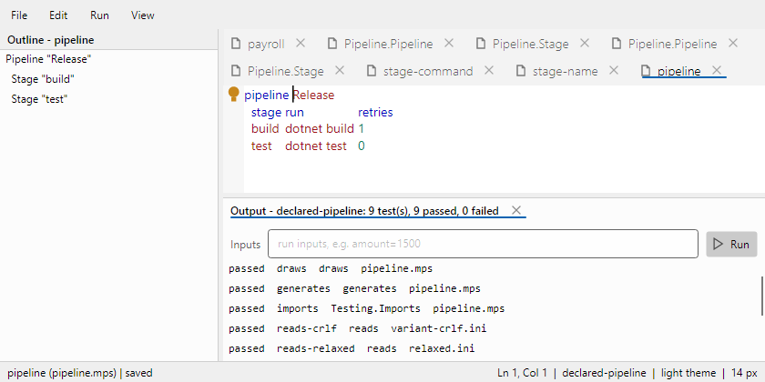

### Import as a declaration: a language that reads its own files

Every other aspect of a language can be written as a model—its concepts, its notation, its types, its generator, its constraints, its scopes, its intentions and now its tests. Reading was the one that could not: an importer was a C# interface, so a language that lived in a project folder printed its documents and could never read one back.

It needs no second grammar. A generator already says how the language is printed, so `TemplateImporter` reads exactly what it writes—no new declaration at all. For a file that does *not* look like the generator's output there is a second, explicit form: `Import.Rules` in an `import` folder, one document per importer, with the verbs a template has (an anchor, a capture, a nest, a repeat), the ones a proof case added (a run kept verbatim, a run remembered and required again, a rule's own refusal), and lexical classes—a word, a number, a quoted run, a fixed run—beside text that produces no node, so whitespace and comments step out of the way. One part exists only because a value has to end: `line` reads the rest of the line and steps over the break, because a newline written as a literal leaves the carriage return of a Windows file in the model. Here is the `relaxed` importer of the pipeline sample, drawn by the notation that aspect ships:

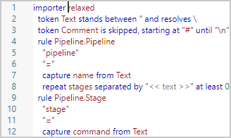

Writing it as a model is what makes it declarable rather than merely configurable: the rule names a property, the slot decides which concept may stand there, and every ambiguity—two anchors that begin alike, a repeat whose separator its own entry begins with—is refused when the importer is built rather than discovered halfway through a file. `samples/declared-pipeline` uses it to read an ini-shaped variant no generator would write, and its own `tests/` folder asserts that reading it yields the model the generator prints.

**File ▸ Import…** is that rule, run from the app: the file is offered to the languages opened in the window first and to the five built-in formats after, and the first importer that reads it opens a document with that language's own types, constraints, scopes, intentions and generators. The order matters, and finding out why cost a picture: a TOML shape check happily claims `pipeline = Release` and then refuses it, so asking the built-ins first made the declared rule unreachable for the very file this sample ships.

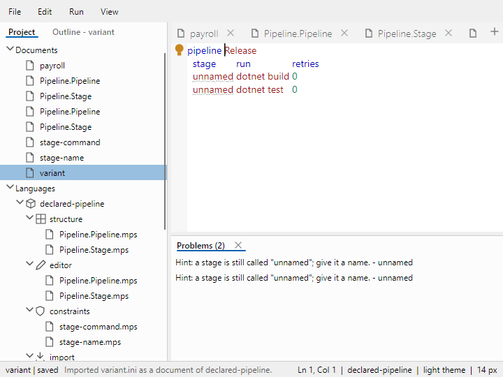

### Feature Gallery

One screenshot per feature, each rendered from the shipping code rather than drawn by hand—so a picture cannot show a state the editor no longer reaches. `tools/Projectional.Screenshots` drives a real session into each state with the public API a host uses and writes the PNGs into `docs/images`: the editor features are rendered from the control, a feature that lives in the shell is rendered from a real `MainWindow`, and a dialog is rendered from the window it was opened over. All three kinds are produced by the same command:

```powershell
dotnet run --project tools/Projectional.Screenshots
```

#### Completion: `Ctrl` + `Space`

An empty condition slot offers the concepts that could fill it, in the language's declaration order, with icons, and the highlighted entry's description underneath. Typing while the list is open filters it instead of editing the document.

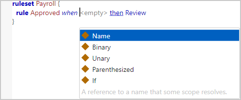

#### Quick fixes and intentions: `Alt` + `Enter` / `Ctrl` + `.`

The bulb in the margin says something can be done at this line. The gesture always opens the list—repairs from the checks and intentions from the language side by side—and never applies anything unasked.

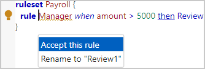

#### Find usages: `Alt` + `F7`, and go to definition: `Ctrl` + `B`

`Find usages` answers the reverse of a reference: who points at the node the caret names, across every model of one project, in document order. The panel lists one row per usage and choosing a row puts the caret on the reference it names—opening that document first when it is already open in a tab. `Ctrl`+`B`—or `Ctrl`+click on a use—goes the other way: the caret moves to the declaration, with its name selected. The declaration has to be drawn in the open document; a target that is not on the page is refused with a reason rather than guessed.

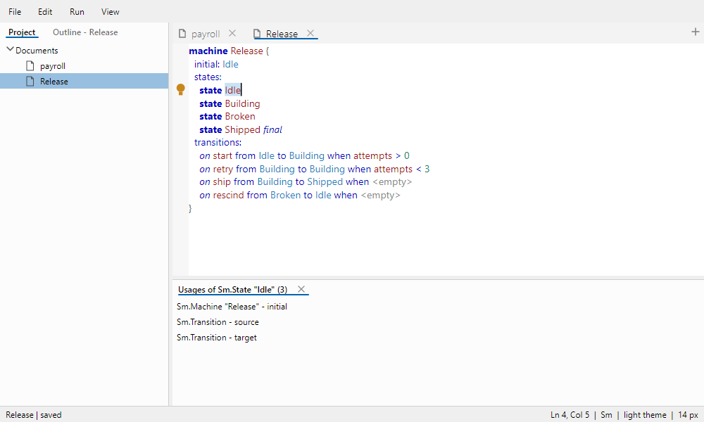

#### Selection ladder: `Ctrl` + `A`

One press selects the value at the caret, the next the whole node with its children, the last the document. `Delete` acts on whatever rung is selected; text actions fall back to caret behaviour when the range spans cells.

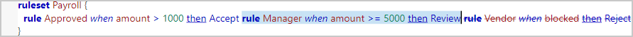

#### Folding

A concept that declares a `collapseSlot` can be folded. The twisty in the margin toggles the node, and the collapsed line keeps the node's identity, its caret places and its addressing intact.

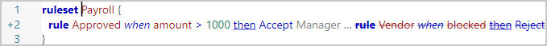

#### Concept triggers

Typing at the edge of a node asks the language what the character means when no property accepts it. `10` then `+` becomes an addition with the literal on its left and the caret in the empty operand, in one undo step.

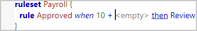

#### Empty values say what belongs there

An empty slot is never invisible: a property cell shows the stand-in its notation declares—`<<operator>>` for an expression's operator—so a value that is still missing reads as a question rather than as a gap. The text is display only, drawn in the placeholder colour; typing starts from an empty cell and the value replaces the stand-in.

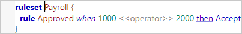

#### Syntax highlighting

The projection decides what a cell *means*; a swappable palette decides how it looks. Keywords, properties, numbers, enumerations and missing values each read differently, and changing the palette is a repaint rather than a re-projection.

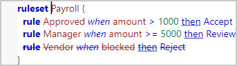

#### Emphasis

Bold, italic, underline and strikethrough come from two places: the notation (`ruleset` is bold, `when` italic, `then` underlined) and a model-driven decorator—here every rule whose outcome is `Reject` is struck through, without a byte of formatting being stored.

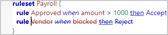

#### Type annotations

The type of a node is drawn beside it in grey, the way an editor shows an inlay hint: `TypeOf` is a notation cell, so the concept's own editor decides whether it appears at all and where on the line it sits - here after each literal's value. The text is the type the language's own type rules compute, read while the tree is built, so it is part of the layout rather than a decoration painted over it: the caret, the selection and the hit test move over the cells the annotation is made of. A language with no type rules leaves the cell out and its documents read exactly as before.


#### Line numbers

An optional gutter tracks the projected lines instead of a text buffer's newlines, so a node that spans several lines is numbered where it is drawn.

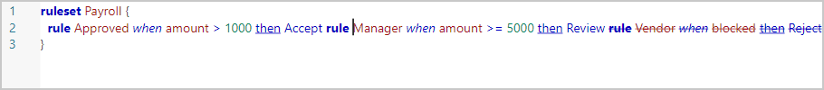

#### Markers

Diagnostics are drawn as squiggles over the stretch they are about: solid for errors and warnings, dotted for information and hints. A diagnostic names a node, a slot and an optional range—never a cell—so a check runs on a model nobody is drawing.

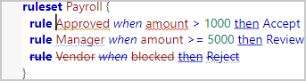

Hovering a squiggle opens its message, the severity, the check's code and the repairs it offers. The box is painted by the control, so it stays inside the document's own bounds.

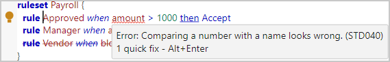

#### Concept and property descriptions

Hovering a node for a moment shows the description its concept declares; a slot's own description appears while the value is still empty, and — when the slot asks for it with `showDescriptionWhenFilled` — over a filled value too, which is what the built-in languages do for keys, type names and operators. A finding's tooltip always wins over a description.

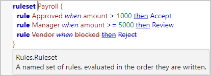

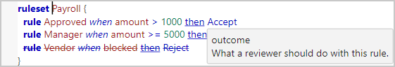

#### Font size

The document is laid out with the same font the control paints with, so zooming simply changes that font: line height, cell widths, gutter, caret and lists all follow, from `6` to `48` px.

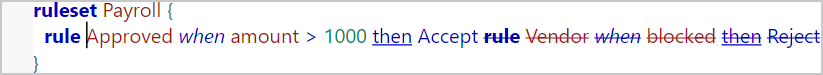

#### Themes

`SyntaxTheme` carries the text palette *and* the surfaces painted over it—background, gutter, caret, selection, markers, lists, tooltips, bulb and the preview ghost—so a dark editor has no white box left in it.

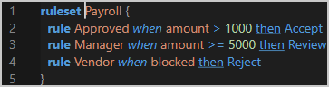

#### Representations

A concept can be drawn more than one way. Here the same ruleset is read as a table; the choice is view state, never model state, and a shown slot keeps its natural address so caret, selection, hit test and undo need no knowledge of variants.

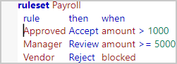

*A table is not a rearrangement of lines: a column names a slot of the row concept rather than a cell, which allows rows of different concepts that declare the same slot to share a grid.*

#### Running a document: `F5`

A document runs through the interpreter its own language declares, so one whose language defines none is refused instead of being run with another language's rules. The output panel puts the answer in its header and the trace underneath—one row per step, a row pointing back at the node that produced it—and the inputs line is read at the moment of the run, never on a keystroke.

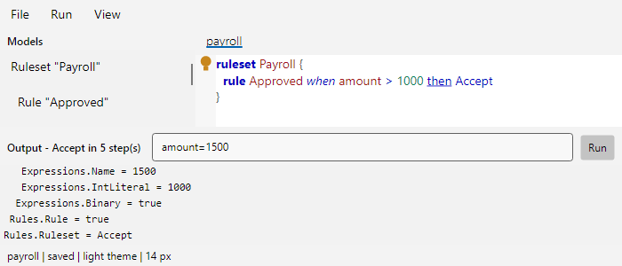

#### Generating text: `Run` ▸ `Generate text`

A language declares as many generators as it likes, so the submenu is built from the active document rather than written in the shell. The panel shows one row per generated line and the header counts the characters and the regions the traceability map knows, so "where did this line come from" is a gesture rather than a search.

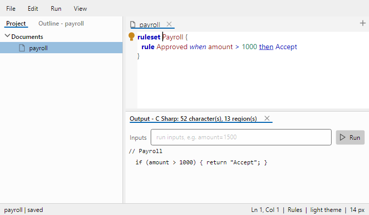

#### The shell: what is open, and what a language is made of

The left column answers two questions with two tabs. The project explorer lists the open documents and the opened
languages—each language as its aspect folders, drawn in the colour that aspect carries everywhere else, with a letter
badge on a definition file naming the kind of definition it holds. The outline beside it lists the document in front.

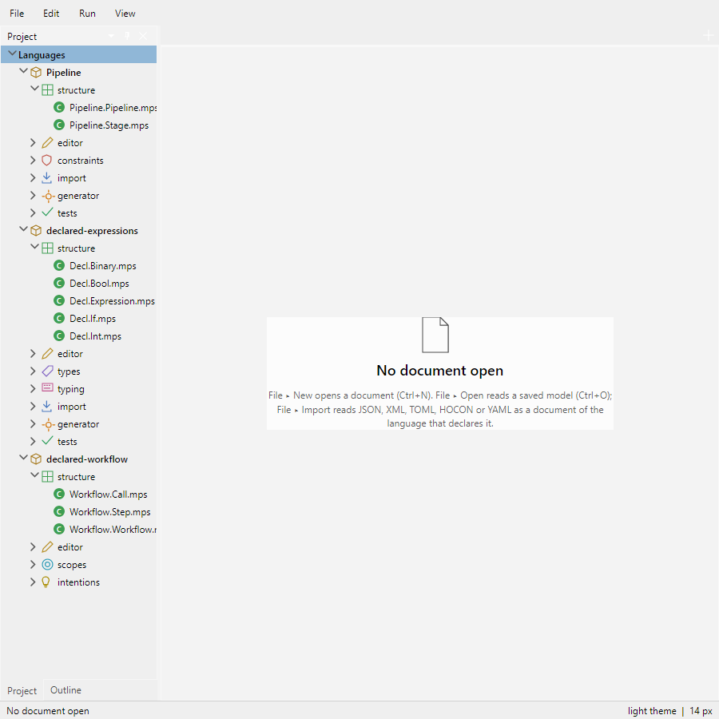

*A folder says what it holds and a file says what kind of definition it is: a green `C` under `structure` is a concept,
an amber `E` under `editor` is a notation.*

#### The outline: the document in front, as a tree

The other tab is the model browser. It walks the model rather than the drawing—so a concept without notation is still
part of it—and draws each row as the concept it is: the concept's initial in a colour that concept owns, identical in
every document. Nodes fold, the eye moves the tree to the caret without moving the caret, and the menu expands or
collapses the whole tree at once.

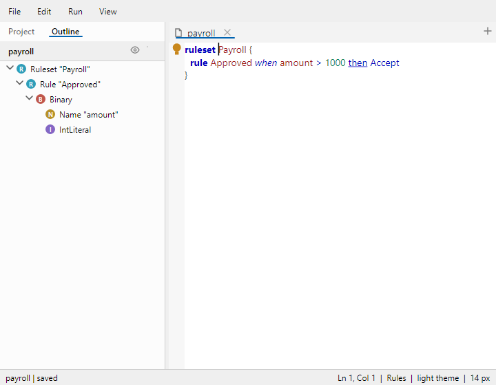

*One colour per concept, not one icon per row: five rules and their outcome read as two families at a glance.*

#### The terminal: a program of your choosing

`View` ▸ `Panels` ▸ `Terminal` opens a dockable tool that runs any program: the output is painted by a real
terminal emulator - VtNetCore's VT100/xterm engine, behind a control of our own ([ADR 0023](docs/adr/0023-terminal-is-vtnetcore-behind-our-control.md)) -
and the keyboard goes back into the program's input. It is the shell's first way to watch something it did not itself run.

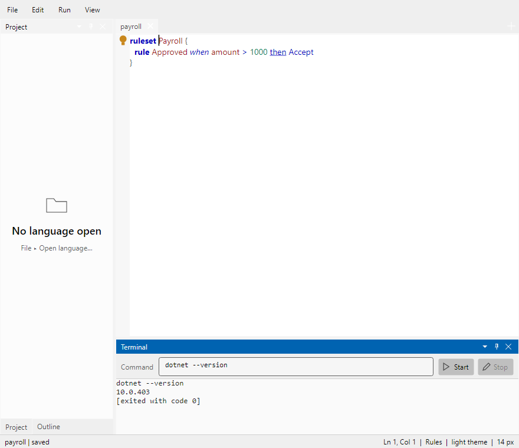

The honest limit is that there is no pseudo-terminal yet: the child's streams are pipes, so it does not echo and does not
do line editing, and the panel shows the visible part of what it sends instead ([terminal.md](docs/architecture/terminal.md)).

#### Module settings: what a language says about itself

A right press in the explorer offers `Module settings…` for the module under the pointer: its identity and versions,
the language each aspect is written in, what the shell built out of the definitions, and where its documentation goes.
Everything but the three settings that are the author's is derived from the folder and from the language that was
loaded, so the dialog also answers "why is this document's page empty".

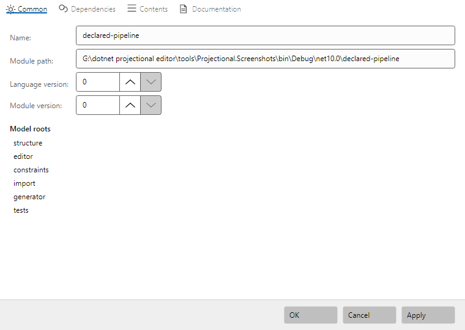

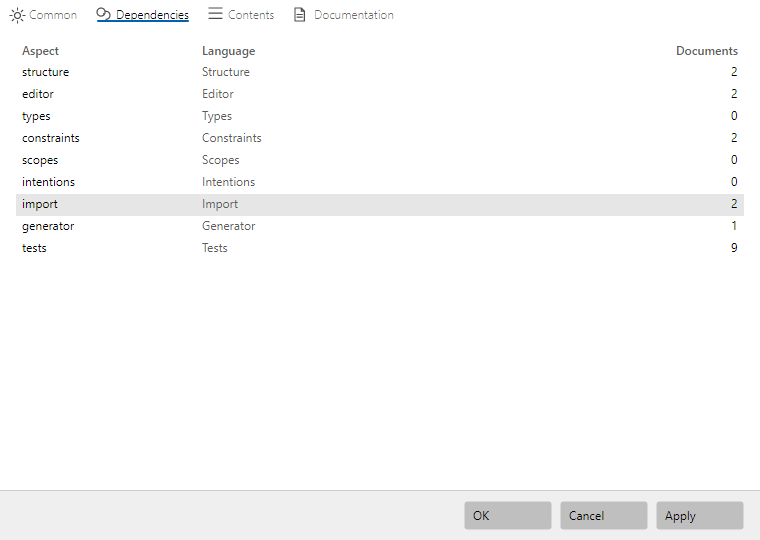

---

## Projects Architecture

The dependency arrows point downward only. `Projection` and `Editing` never reference Avalonia, keeping layout and editing testable headlessly.

`Core` → `Language` → `Projection` → `Editing` → `Avalonia` → `Workbench`

| Project | Layer | Responsibility |
| --- | --- | --- |
| `Projectional.Core` | Model | Nodes, concepts, identity, change journal, undo history, invariants |
| `Projectional.Language` | Notation | Declarative notation, emphasis, notation registry and validation |
| `Projectional.Projection` | View | Cell tree building, layout, headless snapshots, style by meaning |
| `Projectional.Semantics` | Diagnostics | Severity, range, and finding vocabulary |
| `Projectional.Editing` | Editing | Caret, selection, edit actions, key routing, completion, clipboard, markers |
| `Projectional.Persistence` | Storage | Deterministic XML reader and writer |
| `Projectional.Avalonia` | Frontend | Embeddable control, palette, text measure, completion popup |
| `Projectional.Workbench` | Application | Standalone editor: tabs, menus, files, dirty prompts |

---

## Documentation

| Document | Content |
| --- | --- |
| [docs/README.md](docs/README.md) | Documentation map and reading order |
| [docs/architecture/overview.md](docs/architecture/overview.md) | Layers, projects, data flow |
| [docs/architecture/model.md](docs/architecture/model.md) | Node model, identity, change tracking |
| [docs/architecture/language.md](docs/architecture/language.md) | Concepts, notation, variants |
| [docs/roadmap.md](docs/roadmap.md) | What is left, milestone by milestone |
| [docs/implemented.md](docs/implemented.md) | What is finished, where it lives and what proves it |
| [docs/adr/](docs/adr/) | Architecture Decision Records |

---

## Build and Test

```powershell
dotnet build
dotnet test
```

- **SDK Pinned:** `global.json` pins SDK **10.0.403** with `rollForward: latestFeature`. Do not remove it.
- **Central Package Management:** Properties live in `Directory.Build.props`, package versions in `Directory.Packages.props`.
- **Testing:** Powered by xunit.v3 on Microsoft.Testing.Platform (`tests\Projectional.Core.Tests\bin\Debug\net10.0\Projectional.Core.Tests.exe`).
- **Screenshots:** `dotnet run --project tools/Projectional.Screenshots` rewrites every PNG in `docs/images` from the shipping code—the editor features and the three example languages from the control, each through its own language, the shell's own features from a real `MainWindow`—so the galleries above cannot drift from what the app draws.

---

## Known Limitations

- **Host scrollbars required:** The control implements `ILogicalScrollable`, so hosts must wrap it in a `ScrollViewer`.
- **List slots project inline unless asked to stack:** `Children(slot)` runs children horizontally; `Children(slot, stacked: true)` starts each one on a new line.
- **Default property typing:** Typing into a defaulted property inserts characters in front of the default value until proper defaults land.
- **Append-only lists:** `Enter` appends items to list slots (insert-at-index is planned).
- **Diagnostics clipping:** Tooltip boxes are rendered inside control bounds, which may clip text if near edges.

---

## Non-Goals

- No parser, no text buffer as the source of truth, no text-mode fallback.
- No hand-built UI per language; everything language-specific is declarative.
- No multi-user collaboration or graphical diagram editing before 1.0.

---

## License

Licensed under the [Apache-2.0 License](LICENSE) — see [LICENSE](LICENSE) and [NOTICE](NOTICE).
