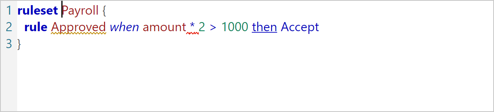
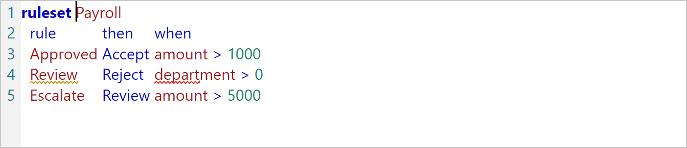
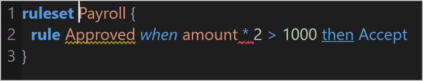

# Projectional Editor for .NET



A **projectional editor** for .NET, modelled after JetBrains MPS: models are trees of
nodes, not text buffers. Notation is *projected* from the model, and every keystroke is
interpreted as a structural edit. This makes it possible to define domain-specific
languages without writing a parser, and to give each language a notation that fits the
domain — text-like, tabular, form-based or diagrammatic.

The editor is designed to be embedded as a component in other .NET applications: either
as a design-time language workbench, or as an end-user model editor inside a shipped
product.

Two consequences are the reason this exists:

- **You build a DSL without a grammar.** A language is a set of concept declarations plus
  a notation. Both are data registered into an explicit registry — no reflection, no
  source generator, no lexer, no parse tree to keep in sync with an AST.
- **The editor is a component, not an application.** `ProjectionalEditorControl` is one
  Avalonia control with a small public surface, and it is the same control the shipped
  standalone editor uses.

## Status

| | |
| --- | --- |
| Milestones | **M0 complete**, **M1 (projection and editing) in progress** |
| Runtime | `net10.0`, C# 14, Avalonia 12 |
| Tests | 880 passing (`dotnet test`) |
| CI | Windows and Linux, plus a Linux-only job that guards the file format |

What that means in practice: you can declare a language, project it, open a document,
edit it structurally with keyboard and mouse, copy and paste, undo and redo, complete
slots, switch a concept's representation, see diagnostics as squiggles, show line numbers,
zoom the font, save to XML and load it back byte-identically.

Not there yet: scrollbars (content larger than the control is clipped), a model browser, a
problems panel, generators and interpreters. See the [roadmap](docs/roadmap.md).

## Why projectional

- **No parser, no invalid syntax.** Every keystroke is an edit action against a model that
  is validated on every mutation, so a document cannot be in a state the language forbids.
- **Notation is a view, not a source file.** The same ruleset is drawn as a block or as a
  table ([ADR 0012](docs/adr/0012-concept-rendered-more-than-one-way.md)); the choice is
  view state and never touches the model.
- **Cells, not characters.** The caret moves between *cells* the projection produced.
  Arrows move by cell, `Ctrl`+arrows by character, so a press never creeps through a
  seven-character property one letter at a time.
- **The model is the only truth.** No text buffer, no whitespace semantics, no
  "sync the text back into the tree" path
  ([ADR 0002](docs/adr/0002-model-as-source-of-truth.md)).

## Quick start

The snippets below build on each other: a language, a model of that language, then a
control that shows it.

### Run the standalone editor

```powershell
git clone <this repository>
cd "dotnet projectional editor"
dotnet run --project src/Projectional.Workbench
```

The workbench opens with the sample rules language. Tabs hold documents, the status bar
tracks the active one, and closing a modified tab asks before it discards anything.

| Menu | Entries |
| --- | --- |
| File | New (`Ctrl+N`), Open… (`Ctrl+O`), Save (`Ctrl+S`), Save as… (`Ctrl+Shift+S`), Close document (`Ctrl+W`), Exit |
| View | Representation (one submenu per concept with more than one variant), Line numbers, Increase font size (`Ctrl+=`), Decrease font size (`Ctrl+-`), Reset font size (`Ctrl+0`), Follow system theme, Light theme, Dark theme |

### Define a language

A language is concepts (the model) plus notation (the view). Both are plain data:

```csharp
ConceptDeclaration[] declarations =
[
    new("Todo.List",
        [
            new PropertySlot("name", PropertyType.String, "todo"),
            new ChildSlot("items", "Todo.Item"),
        ],
        nameSlot: "name"),

    new("Todo.Item",
        [
            new PropertySlot("title", PropertyType.String, "untitled"),
            new PropertySlot("done", PropertyType.Boolean, "false"),
        ],
        nameSlot: "title"),
];

var concepts = ConceptRegistry.Create(declarations);
var notations = new NotationRegistry(concepts);

notations.Add("Todo.List", ed => ed.Sequence(
    ed.Line(ed.Keyword("todo", TextEmphasis.Bold), ed.Space, ed.Property("name"), ed.Space, ed.Punct("{")),
    ed.Indent(ed.Children("items")),
    ed.Line(ed.Punct("}"))));

notations.Add("Todo.Item", ed => ed.Line(
    ed.Punct("-"), ed.Space, ed.Property("done"), ed.Space, ed.Property("title")));
```

`Sequence` stacks blocks vertically, `Line` runs cells horizontally, `Indent` stacks them
one level deeper, and every slot cell names the slot it shows. The inline/block split is
carried by the type system rather than by validation: `Line` takes inline cells and
`Sequence` takes block cells, so `ed.Line(ed.Indent(...))` does not compile.

Notation is validated at the `Add` call, not at render time: a cell naming a slot the
concept does not declare, a duplicate notation, or a single-child cell on a list slot is
rejected there and leaves the registry clean. A concept with no notation at all still
opens and displays — it shows as a missing-notation placeholder, because a language is
written concept by concept.

### Build a model

```csharp
var project = new Project(concepts);
var model = project.NewModel("todos");

var list = model.NewNode("Todo.List");
model.AddRoot(list);

var item = model.NewChild(list, "items", "Todo.Item");
item.Set("title", "write the README");
```

`Project` is the identity scope: node IDs are stable GUIDs that are unique within it and
never renumbered. Every mutation runs inside a transaction and emits change events, which
is where undo, the dirty flag and the projection's rebuild come from — nothing observes
the model by polling.

### Embed the editor in your application

```csharp
var editor = new ProjectionalEditorControl
{
    FontSize = 16,
    ShowLineNumbers = true,
};

editor.Session = new EditorSession(list, notations, editor.TextMeasure);
```

Two statements rather than one object initializer, because the session needs the
*control's own* measure: layout has to be computed with the same font the control paints
with, or the caret and the glyphs disagree.

Everything else — palette, marker colours, caret brush, gutter colours, typeface — is an
optional property on the control, so a host can theme the editor without touching the
model. The control has a parameterless constructor, so it can also be placed in XAML and
sized by the surrounding layout.

### Save and load

```csharp
ModelFile.Save(model, "todos.mps");

var reopened = new Project(concepts);
var reloaded = ModelFile.Load(reopened, "todos.mps");
```

Loading needs a project of its own: a project holds each node id at most once, so opening a
document into the project that already contains it reports a duplicate id rather than
silently merging two copies of the same nodes.

The format is XML, written so that a reader sees either the old file or the new one and
never a half-written mixture: bytes go to a temporary file next to the target, are flushed
to disk, and only then take the target's place. Serialization is byte-stable — slot order
is declaration order, attribute order is fixed, LF endings, UTF-8 without BOM, two-space
indent — so save → load → save produces identical bytes across the whole corpus
([ADR 0005](docs/adr/0005-xml-persistence.md)). Loading never drops data: an unknown
concept, an unknown property or an unresolvable reference is preserved and reported as a
diagnostic.

### Report a problem in the document

Diagnostics are view state, so they are handed to the session and never stored in the
model:

```csharp
editor.Session.Markers = new MarkerSet(
    new Diagnostic(DiagnosticSeverity.Error, item.Id, "The title is still a placeholder.", role: "title"));
```

A diagnostic names a node plus a slot and an optional range within that slot's value. It
never names a cell or a screen position, because cells are derived — so a check can run on
a model nobody is drawing, and a diagnostic survives a notation change.

The set is a snapshot, not a subscription: republish it after every change to the model, or
the marks will describe the document as it was before the edit. Replacing the set is cheap
(the control repaints and keeps its tree and layout), so a host can run its checks on every
committed transaction. `Projectional.Workbench` does exactly that — its `DefaultNames` check
marks every node whose name is still its concept's placeholder, and it is the reference for
what a host can do with the public surface alone.

Hovering a mark opens a small box with the severity, the message and the diagnostic's code.
The box is drawn by the control rather than by a popup window, so it stays inside the
control's own bounds and shows up in a screenshot like the rest of the document.

## What the editor does

### Editing

| Gesture | Action |
| --- | --- |
| `←` / `→` | previous / next cell |
| `Ctrl`+`←` / `Ctrl`+`→` | previous / next character |
| `↑` / `↓` | previous / next line, keeping the column |
| `Home` / `End` | start / end of the line |
| `Tab` / `Shift`+`Tab` | next / previous slot |
| `Enter` | insert a child, or a line break inside a text cell |
| `Alt`+`↑` / `Alt`+`↓` | move the node under the caret |
| `Backspace` / `Delete` | delete a character, or the node when no text is left |
| `Ctrl`+`A` | widen the selection: the value, then the node, then the document |
| `Ctrl`+`C` / `Ctrl`+`X` / `Ctrl`+`V` | copy / cut / paste |
| `Ctrl`+`Z` | undo |
| `Ctrl`+`Y`, `Ctrl`+`Shift`+`Z` | redo |
| `Ctrl`+`Space` | completion |
| `Esc` | dismiss the completion popup |

Keys held with `Ctrl`, `Alt` or `Meta` belong to the host application, with two
exceptions: `Ctrl`+arrows (the plain arrows already move a whole cell) and
`Alt`+`↑`/`↓` (the vertical arrows do nothing else). A refused edit stays unconsumed, so a
letter typed into a number leaves the event open for the host to beep or reroute.

More than one key is a real feature here rather than a courtesy:

- **Structural editing.** `Enter` fills an empty slot with the concept the language says
  is the most likely one, `Backspace` at a boundary deletes the node instead of doing
  nothing, and `Tab` walks the slots in the order the notation declares them.
- **Completion with pictures.** `Ctrl`+`Space` offers the concepts valid in the slot, or
  the declared values when the slot is an enumeration. Icons are vector `IImage`s, not
  glyphs, so they cannot turn into boxes on a machine whose font lacks the character.
- **A described context menu.** The right-click menu is built from the same action objects
  the keyboard uses, so its gestures cannot drift from the bindings, and a host can render
  it without knowing anything about editing.
- **A selection ladder.** `Ctrl`+`A` cannot mean one thing in a document that nests three
  units, so it climbs: the value under the caret, then the whole node, then the document.
  `Delete` acts on whatever rung is selected, removing the covered nodes in one undo step.
- **Double click selects a word, triple click the whole value.** Clicking twice on an editable
  cell — a name, a number, an enumeration symbol — selects the word under the pointer, and a
  third click widens to the cell's whole text, so one keystroke replaces just that much instead
  of inserting into the middle of a word. Clicking twice on a keyword or a placeholder is left
  alone rather than widening to the node.
- **A working clipboard.** Copy and cut take the selected text; paste types the clipboard
  text at the caret through the same validation a keystroke goes through, so a number cell
  refuses `"abc"` instead of storing it. Structural paste of a whole subtree is M3 — it
  needs concept resolution for a fragment that came from another document.

### View

| Feature | What it does |
| --- | --- |
| Syntax highlighting | The projection says what a cell's text *means*; a swappable palette says what that looks like. Swapping a palette is a repaint, not a re-projection. |
| Emphasis | Bold, italic, underline and strikethrough, declared by the notation and/or resolved per node by the language. Emphasis changes glyph advances, so it is known when the tree is built, never added at paint time. |
| Line numbers | An optional gutter that aligns with the projected lines; the width follows the digit count. |
| Markers | Diagnostics drawn as coloured squiggles — solid for error and warning, dotted for info and hint — under the exact cell a diagnostic points at. Hovering one opens a box with the severity, the message and the code. |
| Font size | Settable from code at any positive size; the View menu zooms between `6` and `48`. Layout, caret, hit test and squiggles all follow. |
| Themes | Light and dark palettes, both presets, `Of(ThemeVariant)` to pick the one a desktop asks for, and a `Create` factory for a host's own colours. |
| Representations | A concept can be drawn more than one way. Switching is a view action: no undo step, nothing persisted. |

The same ruleset as a table, with one rule per row and a header row of column names:



And in the dark theme:



A table is not a rearrangement of lines: a column names a *slot of the row concept*, not a
cell, which is what lets one table draw rows of different concepts that declare the same
slot. Headers are projected from the node owning the table, so a table with zero rows still
knows its shape.

## Projects

The dependency arrows point downward only. `Projection` and `Editing` never reference
Avalonia, which is what keeps layout and editing testable headlessly and leaves a second
frontend possible.

`Core` → `Language` → `Projection` → `Editing` → `Avalonia` → `Workbench`

| Project | Layer | Responsibility |
| --- | --- | --- |
| `Projectional.Core` | model | Nodes, concepts, identity, the change journal, undo history, invariants |
| `Projectional.Language` | notation | Declarative notation, emphasis, the notation registry and its validation |
| `Projectional.Projection` | view | Builds the runtime cell tree, lays it out, renders headless snapshots, styles cells by meaning |
| `Projectional.Semantics` | diagnostics | The severity, range and finding vocabulary a check produces |
| `Projectional.Editing` | editing | Caret, selection, edit actions, key routing, completion, clipboard, markers |
| `Projectional.Persistence` | storage | The deterministic XML reader and writer |
| `Projectional.Avalonia` | frontend | The embeddable control, palette, text measure, completion popup |
| `Projectional.Workbench` | application | The standalone editor: tabs, menus, files, dirty prompts |

Two more projects are shipped languages rather than layers: `Projectional.Expressions`
(integers, booleans, strings, names, binary and unary operators, parentheses) and
`Projectional.Samples` (the toy rules language in the screenshots). A host borrows their
declarations and adds its own; it never inherits from them. `Projectional.Semantics` also
sits beside the chain rather than inside it: a check consumes a model and produces
diagnostics, so nothing below it needs to know that checks exist.

[ADR 0010](docs/adr/0010-public-api-surface.md) draws the line at `Projectional.Core` and
`Projectional.Avalonia`: those two are the compatibility promise, and everything else is
meant to be `internal` plus `InternalsVisibleTo` for the tests. Today the code is wider
than that — the authoring API, the edit layer and the persistence entry points are public
as well, because the layers below the control are still settling. Treat them as
provisional: they can change in a minor release until the baseline described in the ADR
lands.

## Documentation

| Document | Content |
| --- | --- |
| [docs/README.md](docs/README.md) | Documentation map and reading order |
| [docs/architecture/overview.md](docs/architecture/overview.md) | Layers, projects, data flow |
| [docs/architecture/model.md](docs/architecture/model.md) | Node model, identity, change tracking |
| [docs/architecture/language.md](docs/architecture/language.md) | Concepts, notation, variants |
| [docs/architecture/projection.md](docs/architecture/projection.md) | Editor tree, layout, tables, styling |
| [docs/architecture/editing.md](docs/architecture/editing.md) | Caret, selection, edit actions |
| [docs/architecture/node-moves.md](docs/architecture/node-moves.md) | Reordering a node in its list |
| [docs/architecture/completion.md](docs/architecture/completion.md) | Slot and enumeration completion |
| [docs/architecture/context-actions.md](docs/architecture/context-actions.md) | The described context menu |
| [docs/architecture/clipboard.md](docs/architecture/clipboard.md) | Copy, cut, paste and the selection ladder |
| [docs/architecture/markers.md](docs/architecture/markers.md) | Diagnostics, geometry, squiggles |
| [docs/architecture/line-numbers.md](docs/architecture/line-numbers.md) | The gutter |
| [docs/architecture/font-size.md](docs/architecture/font-size.md) | Zooming the editor |
| [docs/architecture/semantics.md](docs/architecture/semantics.md) | Checks, types, scopes, generators |
| [docs/architecture/persistence.md](docs/architecture/persistence.md) | XML format, project layout, migrations |
| [docs/architecture/integration.md](docs/architecture/integration.md) | Embedding API, plugin model, packaging |
| [docs/architecture/standalone.md](docs/architecture/standalone.md) | The standalone editor |
| [docs/architecture/testing.md](docs/architecture/testing.md) | Round-trip corpus, snapshot harness, CI |
| [docs/architecture/scrolling.md](docs/architecture/scrolling.md) | Viewport and scrollbars (planned) |
| [docs/architecture/import.md](docs/architecture/import.md) | Importing text into a model (planned) |
| [docs/architecture/csharp.md](docs/architecture/csharp.md) | Projected C# as the logic language (planned) |
| [docs/roadmap.md](docs/roadmap.md) | Milestones M0–M7 with acceptance gates |
| [docs/open-questions.md](docs/open-questions.md) | Decision log for unresolved aspects |
| [docs/adr/](docs/adr/) | Architecture decision records |

## Build and test

```powershell
dotnet build
dotnet test
```

- `global.json` pins SDK **10.0.403** with `rollForward: latestFeature`, so CI and a local
  machine compile identically. Do not remove it.
- All shared properties live in `Directory.Build.props`, all package versions in
  `Directory.Packages.props`. A `.csproj` should not repeat `TargetFramework` and should
  not carry a `Version`.
- Warnings are errors, code style is enforced during the build, and analysis runs at
  `latest-recommended`.
- Tests are xunit.v3 on Microsoft.Testing.Platform, so the test project is an executable:
  `tests\Projectional.Core.Tests\bin\Debug\net10.0\Projectional.Core.Tests.exe`. A single
  class runs with `-class "*Name"`.
- The XML corpus under `tests/Projectional.Core.Tests/Corpus/` is the file format: those
  documents must load and save back to the same bytes. Never regenerate one to make a test
  pass — a byte that moves is a wire-format change and needs an ADR.

## Known limitations

Honest list, so nothing here surprises an adopter:

- **No scrollbars.** Content wider or taller than the control is clipped; viewport layout is
  an M1 remainder described in [docs/architecture/scrolling.md](docs/architecture/scrolling.md).
- **A list slot projects inline.** `ed.Children("items")` runs the children horizontally
  until a `Sequence` or `Indent` around it stacks them, which is why the block screenshot
  shows a single rule and the table is the multi-row form.
- **Typing into a defaulted property inserts.** The model cannot tell an unset property
  from a set one, so a `"todo"` default plus a typed `t` reads `"ttodo"` until property
  defaults get their own feature.
- **`Enter` appends.** There is no insert-at-index API yet, so adding to a list puts the
  child at the end.
- **`Ctrl`+`Home` / `Ctrl`+`End` are not routed.** Plain `Home`/`End` move to the start and
  end of the line.
- **The public surface is wider than promised.** More types are public than
  [ADR 0010](docs/adr/0010-public-api-surface.md) allows, and the API baseline that would
  enforce it is not committed yet.
- **The completion popup does not scroll.** It shows a fixed number of rows.
- **A diagnostic tooltip is clipped by the control's bounds.** It is drawn by the control, not
  by a popup window, so a control with no room around the document shows a truncated box rather
  than one floating over its neighbours.

## Non-goals

- No parser, no text buffer as the source of truth, no text-mode fallback.
- No hand-built UI per language; everything language-specific is declarative.
- No multi-user collaboration, no graphical diagram editing, and no
  model-to-model generators before 1.0.

## License

Apache-2.0 — see [LICENSE](LICENSE) and [NOTICE](NOTICE). The rationale (patent grant,
embedding in commercial host applications) is in
[ADR 0003](docs/adr/0003-runtime-and-license.md).
